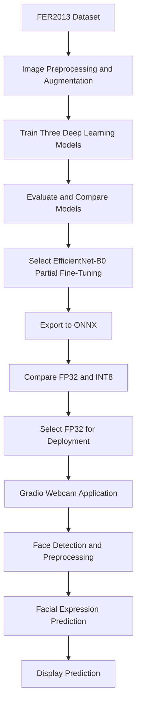

# FER2013-Facial-Expression-Recognition
# Facial Expression Recognition Using Deep Learning

**SDAIA Academy | Computer Vision Systems Development Final Project**

## 1. Project Overview

This project was developed as part of the **Computer Vision Systems Development** training program offered by **SDAIA Academy**, applying the concepts and techniques covered throughout the program.

Using the FER2013 dataset, three deep learning approaches were trained and evaluated for facial expression recognition. The best-performing model was then optimized using ONNX and INT8 quantization and deployed in a webcam-based application.

The project brings together the program's key learning areas: **image preprocessing, deep learning, transfer learning, model evaluation, optimization, and deployment**, while exploring the challenges of real-world implementation.

## 2. Dataset and Preprocessing

**Dataset:** [FER2013 – Kaggle](https://www.kaggle.com/datasets/msambare/fer2013)

- 28,709 training images and 7,178 test images.
- Seven facial expression classes.
- Original image resolution: 48 × 48 pixels.
- Images resized to 224 × 224 and normalized.
- Data augmentation applied during training.
- Stratified validation split created from the training data.

The dataset is imbalanced, with significantly fewer samples of some expressions, particularly Disgust.

## 3. Model Development

Three approaches were implemented and compared:

1. **Custom CNN:** Trained from scratch.
2. **EfficientNet-B0 – Feature Extraction:** Pretrained backbone with a trainable classification head.
3. **EfficientNet-B0 – Partial Fine-Tuning:** Pretrained backbone with the final feature blocks and classification head trained.

Each model was trained for three epochs.

## 4. Model Evaluation

Four metrics were used: Accuracy, Macro Precision, Macro Recall, and Macro F1-score. Confusion matrices were also generated to examine classification errors.

| Model | Accuracy | Macro F1 |
|---|---:|---:|
| Custom CNN | 26.16% | 11.09% |
| EfficientNet-B0 – Feature Extraction | 42.39% | 34.55% |
| EfficientNet-B0 – Partial Fine-Tuning | **52.98%** | **44.18%** |

**Selected model:** EfficientNet-B0 with Partial Fine-Tuning, which achieved the highest Accuracy and Macro F1-score among the three approaches.

## 5. Model Optimization

The selected model was exported to ONNX and optimized using post-training INT8 quantization with 350 calibration images.

| Metric | FP32 | INT8 |
|---|---:|---:|
| Model Size | 15.31 MB | 4.58 MB |
| Accuracy | 52.98% | 34.44% |
| Macro F1 | 44.18% | 23.59% |
| Inference Latency | 15.86 ms | 26.69 ms |

INT8 quantization reduced model size by **70.10%**, but decreased accuracy and increased measured CPU inference latency.

**Deployment decision:** FP32 was retained because it provided better prediction quality and faster inference in our tests.

## 6. Deployment

A webcam-based application was developed using Gradio, OpenCV, and ONNX Runtime.

**Application workflow:**

## System Workflow

The application detects faces and displays the predicted facial expression and confidence score.

## 7. How to Run

1. Open the project notebook in Google Colab.
2. Run the setup, data preparation, and model development cells.
3. Run the deployment cell using the FP32 ONNX model.
4. Open the Gradio application link.
5. Enable webcam access to test live predictions.

## 8. Limitations and Future Improvements

The model showed inconsistent performance across expressions. During webcam testing, it frequently predicted Happy, even for other expressions.

Possible improvements include:
- Addressing class imbalance.
- Training for additional epochs.
- Improving face detection and preprocessing.
- Using more diverse facial expression datasets.
- Improving live-streaming responsiveness.

The system classifies visible facial expressions, not a person's actual emotional state.

## 9. Technologies Used

Python, PyTorch, Torchvision, EfficientNet-B0, Scikit-learn, ONNX, ONNX Runtime, OpenCV, Gradio, Matplotlib, and Google Colab.

## 10. ## SDAIA Academy

This project was developed as part of the **Computer Vision Systems Development** training program offered by SDAIA Academy.

**SDAIA Academy GitHub:** https://github.com/SDAIAAcademy
